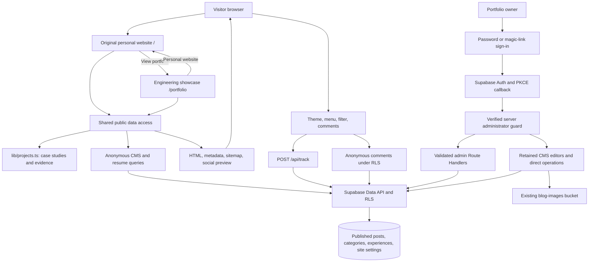
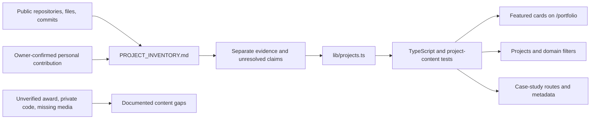

# Architecture

## Design decisions

Verified project content lives in typed, version-controlled TypeScript. The existing Supabase database remains the source for writing, original personal-site experiences, comments, private diaries, analytics, and resume-link settings. The portfolio separately presents bilingual résumé-based experience and team-award highlights. The portfolio can explain the author's engineering work even when the CMS is unavailable. No additional database or content service was introduced.

Next.js App Router, React, TypeScript, and Tailwind remain the stack. Next.js was updated within major version 16 to address the original dependency advisories. Shared project-local tokens/components provide the design system without a second UI framework.

The original personal website remains the root experience. The engineering redesign is a separate `/portfolio` destination, per the owner's correction. Neither landing page redirects away from its own URL.

| Route | Experience and navigation |
| --- | --- |
| `/` | Original personal greeting, portrait, About/Experience/Writing/Contact sections, and **View portfolio** link |
| `/portfolio` | Engineering positioning, featured projects, evidence-backed expertise, and **Personal website** return link |
| `/projects`, `/projects/[slug]` | Project index and case studies; the shared portfolio brand links back to `/portfolio` |
| `/blog`, `/blog/[id]` | Shared writing archive and articles, retaining the personal site's navigation and presentation |

Personal components live under `components/personal/` and their visual rules are scoped to `.personal-site`. Portfolio components use `.home-theme.portfolio-theme`, with presentation rules in `components/portfolio/portfolio.css` and `projects.css`. The engineering UI uses purple/blue accents, rounded cards, and Light/Dark/Color modes. `personal-theme-mode` stores the personal-site preference; the existing `home-theme-mode` key stores the engineering theme. Navigating between routes must not overwrite one preference with the other or inject personal layout styles into the portfolio.

Only `/portfolio`, `/projects`, and project cases offer English and Traditional Chinese. `lib/portfolio-locale.ts` validates `en` / `zh-TW` and preserves language in portfolio links; it leaves personal, Blog, and external URLs unchanged. The server resolves an explicit `?lang=` first, then the `portfolio-locale` cookie, then English. The EN/中文 links work without JavaScript; client clicks additionally save the preference. The portfolio wrapper carries the selected `lang`. Original personal pages and stored CMS content are not translated.



Direct browser-to-Supabase operations are retained functionality. Page guards cannot secure them: deployed RLS must enforce the same role and ownership rules. The proposed hardening SQL was not applied automatically. See [SECURITY.md](SECURITY.md).

## Module and rendering boundaries

| Layer | Main modules | Responsibility |
| --- | --- | --- |
| Public composition | `app/page.tsx`, `app/portfolio/page.tsx`, `app/projects/**`, `app/blog/**` | Separate personal/engineering landing pages with shared server data access |
| Personal presentation | `components/personal/` | Original personal style, navigation, theme preference and root homepage composition |
| Project catalog | `lib/projects.ts`, `lib/project-translations.ts`, `lib/project-archive.ts` | Complete English/Traditional Chinese cases, bilingual additional projects, evidence, team/individual boundaries, media |
| Archive organization | `lib/project-collections.ts`, `ProjectArchive`, `ArchiveSearch` | One primary collection per additional project, short teasers, category-scoped search and native detail disclosures |
| Portfolio localization | `lib/portfolio-locale.ts`, `lib/portfolio-locale-server.ts`, `LanguageSwitcher` | URL/cookie precedence, scoped language links and accessible selection |
| Shared presentation | `components/portfolio/` | Cards, diagrams, section labels, icons, footer |
| Client interactions | `Navbar`, `HomeThemeSwitcher`, `ProjectFilter`, `ArchiveSearch` | Menu state, persisted theme, case-domain filters and category-scoped bilingual archive search |
| Public CMS access | `lib/public-content.ts`, `lib/site-settings.ts`, `lib/supabase/public.ts` | Anonymous published-only reads, bounded timeout, fallback |
| Authentication | `lib/admin-auth.ts`, `lib/admin-policy.ts`, `proxy.ts`, `/auth/callback` | Verified claims, refresh cookies, PKCE exchange |
| API boundary | `lib/api.ts`, `lib/validation.ts` | Same-origin writes, JSON/body limits, allowlists, safe errors |
| Markdown rendering | `components/MarkdownContent.tsx` | Shared blog/editor rendering with raw HTML disabled and safe default URL handling |
| Retained CMS | `app/admin/**`, `DiaryEditor`, `ShareAndComments` | Publishing, diaries, uploads, moderation, settings |

Case-study text and project cards render on the server. The client filter receives rendered cards as slots; filtering state does not require making the full content catalog a client-side renderer. Archive entries have one explicit primary collection and appear under category headings by default. Selecting a category narrows the search scope; clearing search retains the selected category. Short teasers stay visible, while native `details` elements reveal the unchanged full summary, personal contribution, technologies and source links. All entries and these disclosures remain readable without JavaScript. Theme/filter/menu interactions require JavaScript.

The personal homepage and Blog use five-minute revalidation; the sitemap uses one hour. Portfolio routes resolve request-specific language from query parameters or cookies and render on the server for that request. Anonymous CMS reads time out after five seconds, and React `cache` deduplicates repeated reads in a render. Public CMS clients never read login cookies, preventing an administrator's session from leaking drafts into public pages. Admin pages are request-dependent and admin API responses have `Cache-Control: no-store`.

**Outage trade-off:** a failed CMS read returns a deliberate fallback rather than throwing. On routes using five-minute regeneration, this can replace previous CMS entries with an unavailable state until the next 300-second regeneration, even after the database recovers. Typed case studies and their translations remain available throughout. If preserving the last known writing archive becomes necessary, introduce an explicit last-good content strategy with clear freshness semantics.

## Content model and evidence

`Project` includes slug, title, summary, year, role, team, stack, categories, featured status, repository, optional demo, images, sections, evidence, architecture nodes, status, contribution summary, visual style, and optional video. The ten sections cover overview, role, constraints, architecture, flow, implementation, decisions, trade-offs, evidence, and lessons.



Typed data is simpler than MDX or a new CMS schema for this curated catalog: source control carries the review history, TypeScript constrains shape, tests catch missing content, and no migration is needed. The existing Supabase blog stays editable through the existing CMS.

`project-translations.ts` replaces only presentation fields in the seven case-study models. Stable slugs, section IDs, evidence URLs, image paths, and code contents match the English source. Tests check translation coverage and this parity, so a new source paragraph or case requires a corresponding translation. Technology/product names remain intact when they are proper nouns.

Architecture diagrams describe reviewed source code rather than measured deployment traffic. The Atlas screenshot is an actual live capture with provenance in the inventory. Projects without media use labeled system diagrams. No fabricated demo, award, or performance metric is substituted for missing evidence. Snippets render as escaped text. See [CONTENT_GUIDE.md](CONTENT_GUIDE.md) for the publishing workflow.

## Authentication and database access

1. Supabase sign-in uses the public key. Magic links return to `/auth/callback`, exchange a PKCE code using the browser verifier, and redirect to `/admin`.
2. The Next.js Proxy refreshes auth cookies; it is not an authorization boundary.
3. Every admin page/API verifies the user with `auth.getUser()` and checks `app_metadata.portfolio_admin === true`. Editable `user_metadata` never grants access.
4. Mutation routes validate request origin, content type, streamed body size, field names, IDs, URLs, and values. Post mutations also filter by verified author ID.
5. Supabase RLS must independently enforce role/ownership constraints for all browser-direct requests. The supplied hardening script adds restrictive policies and preserves existing rows/permissive grants.

No service-role key is used. The config helper refuses recognizable Supabase secret keys and legacy service-role JWTs; this is defense in depth, not a substitute for keeping secrets out of public build variables. Markdown does not enable raw HTML, comments use escaped React text, and URL inputs allow only HTTP(S) without credentials.

The public image bucket, anonymous insertion abuse risk, nontransactional diary publishing, JWT revocation delay, and unverified deployed policy state are documented in [SECURITY.md](SECURITY.md). Offline tests do not prove production RLS behavior.

## Actual HTTP contracts

These are the application's implemented routes. Supabase also serves its own Data API, authentication, and storage requests directly from existing client components; no invented public API or OpenAPI catalog is added.

All `/api/admin/**` routes, including GET, require a verified administrator session cookie. JSON mutations require `Content-Type: application/json` and reject foreign-origin/cross-site requests. Default body limit: 256,000 bytes; resume updates: 4,096 bytes. Authentication happens before handler validation, so unauthorized requests do not disclose data details.

Admin errors return `{ "error": "safe message" }` and `Cache-Control: no-store`:

| Status | Meaning |
| --- | --- |
| 400 | Invalid fields, malformed JSON, invalid record ID |
| 401 | No verified authenticated user |
| 403 | Ordinary authenticated account or foreign request origin |
| 404 | Requested owned record does not exist |
| 413 | Streamed or declared body exceeds the limit |
| 415 | JSON mutation uses an unsupported content type |
| 502 | Database query/mutation failed |
| 503 | Missing configuration or temporarily unavailable service |

| Route and method | Request | Successful response |
| --- | --- | --- |
| `GET /api/admin/posts` | Admin session | `{ posts: Post[] }`, current author's posts |
| `POST /api/admin/posts` | Required `title`, `content`; allowed optional fields below | `201 { post }` |
| `PATCH /api/admin/posts` | Positive integer `id` and at least one editable field | `{ post }`; author-filtered |
| `DELETE /api/admin/posts?id=123` | Positive integer query ID | `{ message: "Post deleted" }`; author-filtered |
| `GET /api/admin/experiences` | Admin session | Experience array ordered by `sort_order` |
| `POST /api/admin/experiences` | Required `title`, `company`, `period`, `description`; optional `skills`, `sort_order` | `201` experience object |
| `PATCH /api/admin/experiences/[id]` | Positive integer path ID, partial allowed fields | Updated experience object |
| `DELETE /api/admin/experiences/[id]` | Positive integer path ID | `{ success: true }` |
| `GET /api/admin/settings/resume` | Admin session | `{ resumeUrl }`, known original URL fallback |
| `PUT /api/admin/settings/resume` | `{ resumeUrl: "https://…" }` | `{ resumeUrl, updatedAt }` |
| `POST /api/track` | `{ path: "/projects", referrer?: "https://origin.example/…" }` | `{ ok: true }`, anonymous insert under RLS |
| `GET /api/cron/supabase-keepalive` | `Authorization: Bearer <CRON_SECRET>` | `{ ok: true, queries: 3, checkedAt }` |
| `GET /auth/callback?code=…` | PKCE code and browser verifier cookie | Redirect to `/admin`; failure to `/login?reason=callback` |

Allowed post fields: `title` (1–240 characters), `content` (1–200,000), `excerpt` (nullable, ≤1,000), `category` (nullable, ≤80), `spotify_track_id` (nullable or 22 alphanumeric characters), `cover_image` (nullable HTTP(S) URL), and `published` (boolean, defaults to false). Clients cannot assign author IDs, timestamps, or arbitrary database columns. Empty patches are rejected. IDs are canonical positive integers within PostgreSQL integer range.

Experience title/company/period are ≤240 characters; description is ≤10,000. `skills` accepts at most 30 nonempty strings of ≤60 characters. `sort_order` is an integer from -100,000 to 100,000. Unknown fields are rejected.

Example authenticated post creation body:

```json
{
  "title": "A note on data pipelines",
  "content": "## Problem\n\nThe source data needs validation.",
  "category": "Engineering",
  "published": false
}
```

Analytics has an 8,192-byte body limit, accepts public local paths, strips query strings/fragments, retains only referrer origins, and bounds the user agent to 512 characters. Browser tracking skips private routes and respects Do Not Track/Global Privacy Control. No Supabase returns `503 { ok: false, reason: "unavailable" }`; validation returns `400`, database failure `502`, and origin/type/size failures use shared statuses.

Keepalive returns `503` if its secret or Supabase is absent, `401` for a wrong bearer token, and `502` for database failure. It performs three published-post reads in parallel and never updates data. Vercel production still schedules it at 03:00 UTC. It cannot resume a paused project or guarantee free-plan availability.

## Accessibility, SEO, and runtime behavior

- Missing or unreachable CMS yields an explicit unavailable state without fake content. Static case studies, education, contact links, and the original validated resume fallback remain available.
- Unknown project slugs use a 404. Unavailable blog queries are distinguished from a genuinely missing published article.
- Archivo headings and Space Grotesk body fonts are self-hosted with `next/font/local` in both visual scopes; the root retains local Geist as a fallback. Builds do not download fonts. Local images use Next.js optimization. Arbitrary CMS image origins are not added to a wildcard image-proxy allowlist.
- Public pages use semantic regions, one primary heading, a skip link, visible focus states, accessible menu/filter/theme controls, responsive layouts, and reduced-motion rules.
- Metadata includes canonical URLs, Open Graph, a generated social preview, Person/Article structured data, sitemap entries from actual projects/published posts, and crawler exclusions for private routes.
- The engineering UI, case studies and additional project summaries support English/Traditional Chinese. The personal page keeps its original labels and existing article/CMS language is preserved.

## Testing and operations

Vitest covers validation, origin/body boundaries, public config, trusted claims, CMS fallback, content/translation integrity, complete primary category assignments, language selection, and important client interactions. React Testing Library asserts observable behavior. Playwright runs production smoke journeys at 360/390/768/1440px, including the personal → portfolio → personal roundtrip, isolated theme/style state, all 20 works readable without JavaScript, all cases in both languages, category counts and scoped search/clear, native contribution/source disclosures, language persistence and explicit URL precedence, keyboard navigation, metadata, failures, and loaded-font overflow. The smoke build deliberately has no Supabase credentials. Actual outcomes are in [VERIFICATION.md](VERIFICATION.md).

Initial Lighthouse reports measured the earlier engineering landing-page design while it occupied `/`. The engineering section now lives at `/portfolio`; those historical results do not measure the restored personal homepage, the route split, or subsequent portfolio redesigns. Keep measurement URLs and dates with future reports.

GitHub Actions runs lint, typecheck, tests, build, and Chromium smoke tests. Playwright starts `npm run start:standalone`, which copies public/static assets into the traced output and runs the same server layout as Docker. Docker uses a Node 24 multistage build and unprivileged standalone runtime. Public configuration must be provided at build time and changes require a rebuild; `CRON_SECRET` is runtime-only. Vercel retains its Next.js preset and existing cron config. Neither CI nor this implementation automatically runs database migrations or deploys production.

## References

- [Next.js unit-testing boundary](https://nextjs.org/docs/app/guides/testing/vitest)
- [Next.js standalone output](https://nextjs.org/docs/app/api-reference/config/next-config-js/output)
- [Supabase server-side authentication](https://supabase.com/docs/guides/auth/server-side/creating-a-client)
- [Supabase Row Level Security](https://supabase.com/docs/guides/database/postgres/row-level-security)
